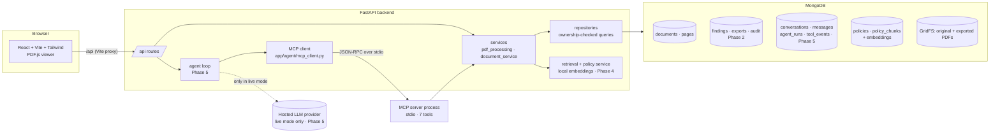

# ClearCase architecture

ClearCase is a local, single-user MVP with four processes: a React frontend, a
FastAPI backend, MongoDB, and an MCP server (Phase 3, built) that the backend's
agent talks to over stdio.



## Layers (and why they are separate)

| Layer | Folder | Responsibility | Knows about |
| --- | --- | --- | --- |
| API | `backend/app/api` | Parse HTTP, call a service, shape the response | FastAPI, Pydantic models |
| Services | `backend/app/services` | Business rules: validation, extraction, lifecycle, deletion cascade | Repositories, PyMuPDF |
| Repositories | `backend/app/repositories` | The only code that runs MongoDB queries; every query filters by `owner_id` | pymongo, GridFS |
| Models | `backend/app/models` | Pydantic schemas shared by API, services and (later) MCP tools | nothing else |
| MCP server | `backend/app/mcp_server` | The seven tools, their schemas and safety rules; runs as its own process | Services |
| MCP client / agent | `backend/app/agent` | `mcp_client.py` (Phase 3): discovery, argument validation, timeouts, size cap. The tool-calling loop arrives in Phase 5 | MCP SDK |

Keeping PDF processing, persistence and HTTP in different modules means each can
be tested on its own: `test_pdf_processing.py` never touches the database, and
the API tests use the real database but never parse a PDF by hand.

## Coordinate model

PyMuPDF reports word rectangles in PDF points with the origin at the top-left of
the **unrotated** page. The viewer renders the page with its `/Rotate` value (and
any user rotation) applied. `frontend/src/lib/geometry.ts` converts between the
two using the stored `PageGeometry {width, height, rotation}`. The same function
will place redaction highlights in Phase 2, so getting it right (and verifying
it with the "Show word boxes" toggle) was a Phase 1 goal.

## Data model (Phase 1)

```text
documents                      pages                          pdf_files.files / .chunks (GridFS)
---------                      -----                          ---------------------------------
_id                            _id                            _id  <- documents.original_file_id
owner_id                       document_id -> documents._id   filename
filename (sanitised)           owner_id                       metadata.owner_id
content_hash (sha256)          document_version               metadata.content_hash
size_bytes, page_count         page_number (1-based)          metadata.kind = "original"
status                         geometry {width,height,rotation}
version                        kind: text|scanned|mixed|empty
extraction {...}               supported, word_count, image_count, image_coverage
processing {...}               text
original_file_id               words [{text, bbox, block, line, word_index, char_start, char_end}]
created_at, updated_at
```

Indexes: `documents(owner_id, created_at desc)`, `documents(owner_id, content_hash)`,
`pages(document_id, page_number) unique`.

## MCP tools (Phase 3)

The agent never imports tool code. It starts `python -m app.mcp_server`, performs
the MCP handshake, lists the tools and their JSON Schemas, and calls them over
stdio. The tools are thin wrappers over the same services the REST API uses.

| Tool | Reads / writes | Notes |
| --- | --- | --- |
| `search_document` | read | literal search, occurrence ids, pages, spans, boxes; lists unsupported pages |
| `get_document_excerpt` | read | ≤ 4,000 characters, resumable with `start` / `has_more` |
| `detect_sensitive_entities` | read | candidates + detector provenance; saves nothing |
| `retrieve_policy_guidance` | read | honest "not available" until Phase 4 |
| `propose_redactions` | writes `proposed` only | span + exact expected text, verified server-side; idempotent |
| `get_review_summary` | read | counts, blockers, unresolved ids; no document text |
| `export_approved_redactions` | creates an export | works only after the *reviewer* issued an authorization |

What is deliberately **not** a tool: approve, reject, adjust, delete, issue an
export authorization. See `docs/decisions.md` 17–23.

```text
agent loop (Phase 5)
   │  call("search_document", {...})
   ▼
McpToolClient ── validate args vs discovered schema ── timeout ── size cap
   │  JSON-RPC over the child's stdin/stdout
   ▼
python -m app.mcp_server  (owner_id from its own environment)
   │  ownership-checked services
   ▼
MongoDB / GridFS
```

## Policy retrieval (Phase 4)

```text
upload / seed ──► policy_chunking ──► policies + policy_chunks (MongoDB)
                                           ▲            │ vectors + model name + revision
                  local embedding model ───┘            ▼
question ──► embed ──► filter (owner · active version · current model) ──► cosine ──► cutoff ──► cited passages
                                                                                       └─► "no matching passage" (a heuristic)
                                                                                             └─► reviewer-only weak matches (never sent to the assistant)
```

| Piece | File | Job |
| --- | --- | --- |
| Chunker | `services/policy_chunking.py` | Markdown → sections → chunks ≤ 140 words (pure function) |
| Embedder | `services/embeddings.py` | Local pretrained model, offline-only, honest `available/unavailable` status |
| Policy service | `services/policy_service.py` | Ingest, versions, embed/re-index, citations |
| Retriever | `services/retrieval.py` | `PolicyRetriever` interface + brute-force cosine implementation |
| API | `api/policies.py` | Upload, list, search, passages, activate, re-index, delete |
| MCP tool | `mcp_server/server.py` | `retrieve_policy_guidance`; `propose_redactions` accepts validated `policy_refs` |

### Data model (Phase 4)

```text
policies                                   policy_chunks
--------                                   -------------
owner_id, policy_id, version  (unique)     owner_id, policy_key = "policy_id:version"
title, source, content_hash                citation_id = "policy_id:version:ordinal"  (unique per owner)
is_fictional_example                       ordinal, section, text, text_hash, word_count
status: active | archived                  embedding: [384 floats] | null
  (one active per policy: partial          embedding_model, embedding_revision, embedded_at
   unique index)                           truncated_by_model
chunk_count, word_count, embedding_note
```

Indexes: `policies(owner_id, policy_id, version)` unique; `policies(owner_id, policy_id)`
unique where `status = active`; `policy_chunks(owner_id, policy_key, ordinal)` unique;
`policy_chunks(owner_id, citation_id)` unique.
