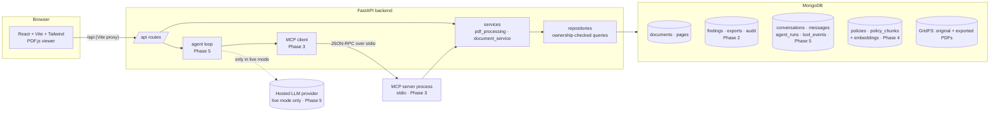

# ClearCase architecture

ClearCase is a local, single-user MVP with four processes: a React frontend, a
FastAPI backend, MongoDB, and (from Phase 3) an MCP server the backend talks to
over stdio.



## Layers (and why they are separate)

| Layer | Folder | Responsibility | Knows about |
| --- | --- | --- | --- |
| API | `backend/app/api` | Parse HTTP, call a service, shape the response | FastAPI, Pydantic models |
| Services | `backend/app/services` | Business rules: validation, extraction, lifecycle, deletion cascade | Repositories, PyMuPDF |
| Repositories | `backend/app/repositories` | The only code that runs MongoDB queries; every query filters by `owner_id` | pymongo, GridFS |
| Models | `backend/app/models` | Pydantic schemas shared by API, services and (later) MCP tools | nothing else |
| Agent / MCP | `backend/app/agent`, `backend/app/mcp_server` | Tool-calling loop and the tool server (Phases 3 and 5) | Services |

Keeping PDF processing, persistence and HTTP in different modules means each can
be tested on its own: `test_pdf_processing.py` never touches the database, and
the API tests use the real database but never parse a PDF by hand.

## Coordinate model

PyMuPDF reports word rectangles in PDF points with the origin at the top-left of
the **unrotated** page. The viewer renders the page with its `/Rotate` value (and
any user rotation) applied. `frontend/src/lib/geometry.ts` converts between the
two using the stored `PageGeometry {width, height, rotation}`. The same function
will place redaction highlights in Phase 2, so getting it right (and verifying
it with the "Show word boxes" toggle) was a Phase 1 goal.

## Data model (Phase 1)

```text
documents                      pages                          pdf_files.files / .chunks (GridFS)
---------                      -----                          ---------------------------------
_id                            _id                            _id  <- documents.original_file_id
owner_id                       document_id -> documents._id   filename
filename (sanitised)           owner_id                       metadata.owner_id
content_hash (sha256)          document_version               metadata.content_hash
size_bytes, page_count         page_number (1-based)          metadata.kind = "original"
status                         geometry {width,height,rotation}
version                        kind: text|scanned|mixed|empty
extraction {...}               supported, word_count, image_count, image_coverage
processing {...}               text
original_file_id               words [{text, bbox, block, line, word_index, char_start, char_end}]
created_at, updated_at
```

Indexes: `documents(owner_id, created_at desc)`, `documents(owner_id, content_hash)`,
`pages(document_id, page_number) unique`.
